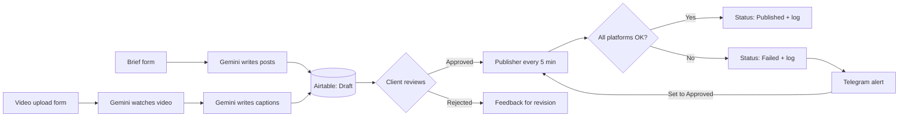

# AI Social Media Automation (n8n + Gemini + Airtable)

An AI-powered social media system that **writes, adapts, schedules and publishes** content for Instagram, TikTok, Facebook and LinkedIn — with a **human approval step** so nothing goes live until the client approves it.

Built as part of my **30-Day Upwork Build Challenge**, where I build real jobs posted on Upwork.

---

## What it does

- **AI content from a brief** — Fill in a short form (business, topic, number of posts). Gemini writes a different version of each post for every platform, plus an image prompt and a Reel/TikTok script.
- **AI captions from a video** — Upload your own video. Gemini **watches it** and writes platform-specific captions based on what is actually in the clip.
- **Platform-specific content** — Each platform gets its own tone and format (hashtags for Instagram, short hooks for TikTok, conversational for Facebook, professional for LinkedIn). Nothing is copy-pasted.
- **Content calendar** — All posts land in Airtable with a calendar view for review.
- **Approval gate** — Posts start as `Draft`. Only posts the client marks `Approved` are published.
- **Automatic scheduling** — Every 5 minutes, approved posts whose scheduled time has passed are published.
- **Status log** — Every publish attempt is logged per platform (✅ / ❌ with the reason).
- **Failure alerts** — If any platform fails, a Telegram alert is sent with the post name, failed platforms and error details.
- **Easy retry** — Set a failed post back to `Approved` and it is retried on the next run.

> **Note:** Publishing is **simulated** in this demo (with a realistic random failure rate) so it runs without platform API approvals. The publisher is a single node — swap it for the official APIs (Meta Graph API, LinkedIn, TikTok Content Posting API) or a posting service to go live. See [Going live](#going-live).

---

## How it works



### Workflows

| File | Trigger | What it does |
|---|---|---|
| `workflows/1-content-generator.json` | n8n form | Brief → Gemini (structured output) → split into posts and schedule one per day → create Airtable rows as `Draft` |
| `workflows/2-publisher.json` | Every 5 minutes | Find `Approved` posts that are due → simulated publish to 4 platforms → update `Status` + `Publish Log` → Telegram alert on failure |
| `workflows/3-video-captions.json` | Every 2 minutes | Find posts with a video but no captions → download video → Gemini analyzes the video → Gemini writes 4 platform captions → save to Airtable |

---

## Tech stack

- **n8n** (self-hosted in Docker) — workflow automation
- **Google Gemini** — text generation and video understanding
- **Airtable** — content calendar, approval board, video upload form
- **Telegram Bot API** — failure alerts

---

## Setup

### 1. Run n8n in Docker

```bash
docker volume create n8n_data

docker run -d --name n8n --restart unless-stopped -p 5678:5678 \
  -e GENERIC_TIMEZONE=America/Los_Angeles -e TZ=America/Los_Angeles \
  -v n8n_data:/home/node/.n8n docker.n8n.io/n8nio/n8n
```

Open http://localhost:5678 and create your owner account.

### 2. Create the Airtable base

Create a base called **Social Media Automation** with a table called **post** and these fields:

| Field | Type |
|---|---|
| Title | Single line text |
| Brief | Long text |
| Instagram | Long text |
| TikTok | Long text |
| Facebook | Long text |
| LinkedIn | Long text |
| Image Prompt | Long text |
| Video Script | Long text |
| Status | Single select: `Draft`, `Approved`, `Rejected`, `Published`, `Failed` (default `Draft`) |
| Scheduled Time | Date, with time |
| Publish Log | Long text |
| Feedback | Long text |
| Video | Attachment |

Recommended views:
- **Content Calendar** — Calendar view on `Scheduled Time`, colored by `Status`
- **Pending Approval** — Grid view filtered to `Status is Draft`

Recommended form: **Submit Your Video** — fields `Title`, `Brief` (required), `Video` (required), `Scheduled Time`.

### 3. Create credentials in n8n

| Credential | Where to get it |
|---|---|
| Airtable Personal Access Token | airtable.com/create/tokens — scopes `data.records:read`, `data.records:write`, `schema.bases:read`, with access to your base |
| Google Gemini API | aistudio.google.com → Get API key |
| Telegram | Create a bot with @BotFather and copy the token |

### 4. Import the workflows

In n8n: **Create Workflow → ⋯ → Import from File**, once for each file in `workflows/`.

Then in each workflow:
1. Select your credentials in the Airtable, Gemini and Telegram nodes.
2. Re-select your **Base** and **Table** in each Airtable node.
3. In **Send Failure Alert**, replace `YOUR_TELEGRAM_CHAT_ID` with your chat ID (message your bot, then open `https://api.telegram.org/bot<TOKEN>/getUpdates` and copy `chat.id`).
4. In the **Code** nodes, set `TIMEZONE` to the client's time zone.
5. Click **Publish** to activate.

---

## How the client uses it

1. **Create content** — Fill in the brief form, or upload a video through the Airtable form.
2. **Review** — Open **Pending Approval** or **Content Calendar** in Airtable and read each platform's version.
3. **Approve or reject** — Set `Status` to `Approved`, or `Rejected` with notes in `Feedback`. Adjust `Scheduled Time` if needed.
4. **Relax** — Approved posts publish automatically at their scheduled time.
5. **Handle failures** — If a Telegram alert arrives, check the `Publish Log`, then set the post back to `Approved` to retry.

---

## Going live

The **Simulate Publish** node in `2-publisher.json` is the only part that fakes publishing. To post for real, replace it with:

- **Official APIs** — Meta Graph API (Facebook Pages, Instagram Business/Creator incl. Reels), LinkedIn API, TikTok Content Posting API. Each requires a developer app and, in some cases, platform review (TikTok posts stay private until the app is audited).
- **A posting service** — e.g. Ayrshare, Upload-Post or Blotato. The client connects their accounts once and n8n posts with a single HTTP request.

Videos are already stored in Airtable with a public file URL, which is what these APIs expect.

---

## Troubleshooting

| Problem | Fix |
|---|---|
| Posts show the wrong time | Set `TIMEZONE` in the Code nodes and `GENERIC_TIMEZONE` in Docker |
| Gemini "model not available" or "high demand" | Switch to another current Gemini Flash model; **Retry On Fail** is enabled on the video node |
| Form test keeps "listening" | Open the Test URL in a new tab while the node is listening, or use the Production URL after publishing |
| Airtable node warns about columns | Click the refresh icon next to **Values to Send** after changing Airtable fields |
| Telegram alert not received | Make sure you have sent `/start` to your bot and the Chat ID is correct |

---

## Author

Built by **[Your Name]** — AI automation builder. [Connect on LinkedIn / Upwork](#)
